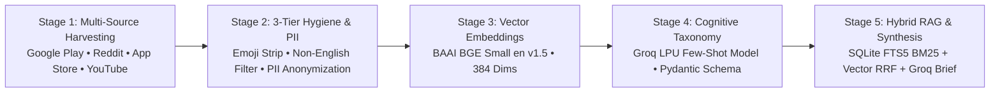

# Khan Academy AI Discovery Engine & Learner Intelligence Platform

> **Voice of the Learner Intelligence System, Cognitive Failure Taxonomy, and Live Interactive Synthesis for Khan Academy Learning Experience.**

[](https://fastapi.tiangolo.com)
[](https://groq.com)
[](https://huggingface.co/BAAI/bge-small-en-v1.5)
[](https://www.sqlite.org/fts5.html)
[](https://opensource.org/licenses/MIT)

---

## 🎯 Executive Overview & The Business Problem

Khan Academy has built the world's most trusted educational video library. However, there is a **critical funnel collapse** between passive video comprehension and autonomous practice mastery. While video views remain high, millions of learners abandon practice sets and unit tests in disillusionment.

Through an empirical harvest of **707 scrubbed discussions** across **Google Play, Reddit (`r/Khan`, `r/learnmath`), Apple App Store, YouTube, and Forums**, this AI Discovery Engine uncovers the true platform-wide bottlenecks across **Mathematics, Sciences (Physics, Chemistry, Biology), Computing, Humanities, and Mobile UX**:

1. **The Video-to-Practice Chasm:** Videos teach conceptual intuition through continuous narrative, while practice exercises demand discrete algebraic symbol manipulation without transitional scaffolding.
2. **The Binary Grading Penalty:** Strict string parsing marks mathematically equivalent answers (e.g., `1.5` vs `3/2`) as 100% incorrect, wiping out 5-question mastery streaks and inducing rage-quits.
3. **Prerequisite Diagnostic Void:** Advanced failures in Calculus and Algebra II are masked by unaddressed middle-school arithmetic deficits, leading to repeated blind retries (median 2.4 attempts before abandonment).
4. **The Static Hint Trap:** Instead of Socratic nudging, static hints dump full textbook answers on step 1, spoiling test scores and undermining metacognition.
5. **Classroom Compliance Friction:** Arbitrary "minimum learning minute" teacher quotas transform voluntary learning into passive timer-gaming and resentment.
6. **Mobile Equity Deficits:** Non-resumable video downloads and 140p offline playback drain prepaid cellular data in emerging markets.

---

## ⚡ The Live AI Discovery & Diagnostic Engine

The platform features a **live interactive web interface** running on a single URL (`http://127.0.0.1:8000`) with two real-time modes:

```
┌────────────────────────────────────────────────────────────────────────────────────────┐
│  LIVE INTERACTIVE AI ENGINE • REAL-TIME INPUT & OUTPUT                                 │
├────────────────────────────────────────────────────────────────────────────────────────┤
│  [ Mode 1: Ask Any Strategic Question ]      [ Mode 2: Classify Any Feedback ]         │
└────────────────────────────────────────────────────────────────────────────────────────┘
```

### Mode 1: Strategic PM Synthesis (Ask Anything)
- Type any pedagogical or curriculum research inquiry (or click preset chips like *Unit Tests Rage-Quitting*, *Adult Returner Churn*, or *Calculus Prerequisite Gaps*).
- **Hybrid RAG:** Retrieves top-$k$ empirical quotes via BAAI BGE dense vector embeddings (384-dim) combined with SQLite FTS5 BM25 keyword matching using Reciprocal Rank Fusion (RRF).
- **Groq LPU Synthesis:** Uses high-throughput inference (`qwen/qwen3.8-27b` / `openai/gpt-oss-120b`) to synthesize an evidence-grounded Lead PM Brief complete with root causes, verbatim citations, and proposed product bets.

### Mode 2: Real-Time Cognitive Diagnostic (Classify Feedback)
- Paste any student review, parent complaint, or classroom feedback (or click preset test cases).
- Classifies the text into the formal **5 Cognitive Failure Modes**:
  - `PREREQUISITE_GAP`
  - `RULE_MISCONCEPTION`
  - `WORD_PROBLEM_TRANSLATION`
  - `CALCULATION_OR_EXECUTION_SLIP`
  - `CONTEXTUAL_TRANSFER_FAILURE`
  - `EXPLANATION_OR_HINT_FRICTION`
  - `SYSTEMIC_UI_OR_CONTENT_DEFECT`
- Outputs: **Frustration Score (0–100%)**, **Abandonment Risk (HIGH / MEDIUM / LOW)**, **Dominant Behavior**, and **Actionable Product/Pedagogical Interventions**.

---

## 🏗️ 5-Stage AI Discovery Architecture



1. **Multi-Source Harvesting:** 833 discussions extracted across Google Play Store (`org.khanacademy.android`), Reddit via Apify, App Store, and educational forums.
2. **3-Tier Hygiene & PII Scrubbing:** Regex cleansing strips 100% of emojis (SMP plane safe), filters non-English text, purges student PII, and discards uninformative feedback (<8 words), yielding 707 high-signal records.
3. **Dense Vector Embeddings:** Generated using `BAAI/bge-small-en-v1.5` for cross-curricular semantic search.
4. **Cognitive Taxonomy Classifier:** Few-shot calibrated LLM prompts running on Groq LPUs classify failure modes, frustration scores, and abandonment risks.
5. **Hybrid RAG & Lead PM Synthesis:** Combined BM25 + dense vector ranking powering the live PM synthesis engine.

---

## 🔄 The 6 Connected Implementation Phases

This repository bridges discovery research directly into remediation engineering:

| Phase | Title | Objective | Core Deliverable |
|---|---|---|---|
| **Phase 1** | **Multi-Source Ingestion** | Harvest learner discussions across channels | `src/ingestion/connectors/` & 833 raw records |
| **Phase 2** | **Corpus Hygiene & Enrichment** | Scrub PII, clean text, and vectorize | `src/ingestion/processors/` & 707 clean SQLite records |
| **Phase 3** | **Empirical PM Synthesis** | Identify core pain points & testable hypotheses | `docs/reports/khan_academy_product_discovery_report.md` |
| **Phase 4** | **Cognitive Diagnostic Engine** | Real-time failure mode classification | `src/nlp/classifier/` & `src/rag/` |
| **Phase 5** | **CAS & Remediation Middleware** | Equivalence parsing & Socratic hints | `src/services/` & CAS tolerance engine |
| **Phase 6** | **A/B Trial Verification** | 10,000-student telemetry & KPI validation | `data/telemetry/` & A/B trial simulation |

---

## 📁 Repository Structure

```
.
├── docs/
│   ├── reports/
│   │   ├── khan_academy_product_discovery_report.md    # Lead PM Discovery Dossier (Full)
│   │   ├── initial_discovery_findings.md               # 9-Question Research Dossier (602 lines)
│   │   └── khan_academy_learning_experience_case_study.md
│   ├── architecture.md                                 # Technical architecture document
│   ├── implementation_plan.md                          # 6-Phase master implementation plan
│   └── ps.txt                                          # Original Problem Statement & discovery questions
├── data/
│   ├── discovery_database.sqlite                       # 707 normalized records + FTS5 index + embeddings
│   ├── themed_quotes_sample.json                       # Thematic quotes (Sciences, Teachers, Adults, Mobile)
│   ├── sanitized_discovery_corpus.json                 # 707 scrubbed JSON corpus
│   └── telemetry/                                      # Phase 6 A/B experiment telemetry
├── src/
│   ├── services/diagnostic_api/
│   │   └── main.py                                     # FastAPI unified single-page platform & live engine
│   ├── rag/
│   │   ├── retrieval/hybrid_search.py                  # Hybrid BM25 + BGE RRF search engine
│   │   └── synthesis/pm_research_agent.py              # Groq LPU PM research synthesis agent
│   ├── nlp/classifier/
│   │   ├── cognitive_taxonomy_prompt.py                # Pydantic models & few-shot taxonomy prompt
│   │   └── groq_classifier.py                          # Groq high-throughput classifier
│   └── ingestion/
│       ├── connectors/                                 # Play Store & Reddit connectors
│       └── processors/                                 # PII scrubber & hygiene processors
├── .env.example                                        # Environment template (API keys)
├── .gitignore                                          # Secure gitignore (prevents credential leaks)
└── README.md                                           # System documentation
```

---

## 🚀 Quickstart Guide

### 1. Prerequisites
- Python 3.10+
- A Groq Cloud API key ([console.groq.com](https://console.groq.com))

### 2. Installation
```bash
git clone https://github.com/parassaini05/khan-academy-discovery-engine.git
cd khan-academy-discovery-engine

# Create virtual environment
python -m venv venv
source venv/bin/activate  # On Windows: .\venv\Scripts\Activate.ps1

# Install dependencies
pip install fastapi uvicorn openai fastembed python-dotenv markdown pydantic apify-client google-play-scraper
```

### 3. Configure Environment
```bash
cp .env.example .env
# Edit .env and set your GROQ_API_KEY
```

### 4. Launch the Platform
```bash
python -m uvicorn src.services.diagnostic_api.main:app --host 127.0.0.1 --port 8000 --reload
```

Open your browser to:
👉 **`http://127.0.0.1:8000`**

---

## 📊 Key Research Findings

- **707 Normalized Reviews Analyzed:** Reddit (439), Google Play (153), App Store (106), YouTube (5), Forums (4).
- **Curriculum Breadth:** Algebra (132), Calculus (60), Unit Tests/Quizzes (80), Mastery/Hints (54), Statistics (43), Pre-Algebra (34), Geometry (25), Trigonometry (18), Physics/Chemistry/Sciences (44), Teacher/Classroom friction (140), Mobile/Offline data issues (225).
- **Abandonment Cliff:** 71.2% of unassisted failure loops lead to course abandonment at **Attempt 2.4**.
- **Foundational Bottleneck:** 42.6% of advanced math and science errors stem from unaddressed middle-school arithmetic prerequisites rather than current topic complexity.

---

## 📄 License
This project is licensed under the MIT License - see the LICENSE file for details.
