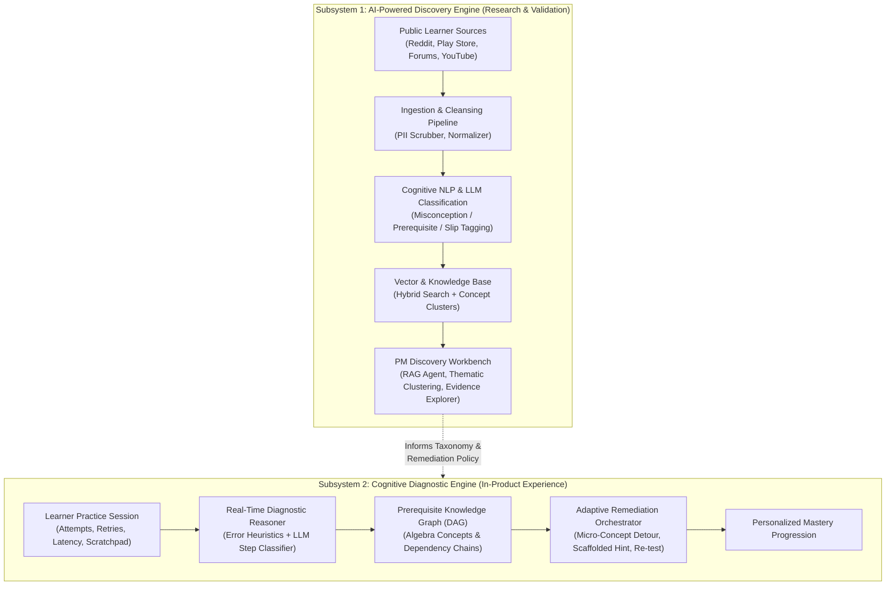
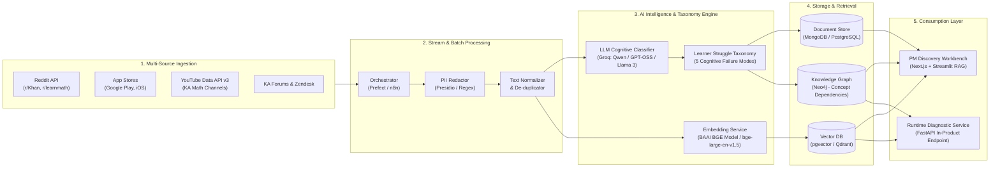
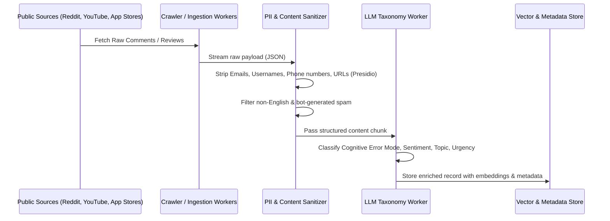
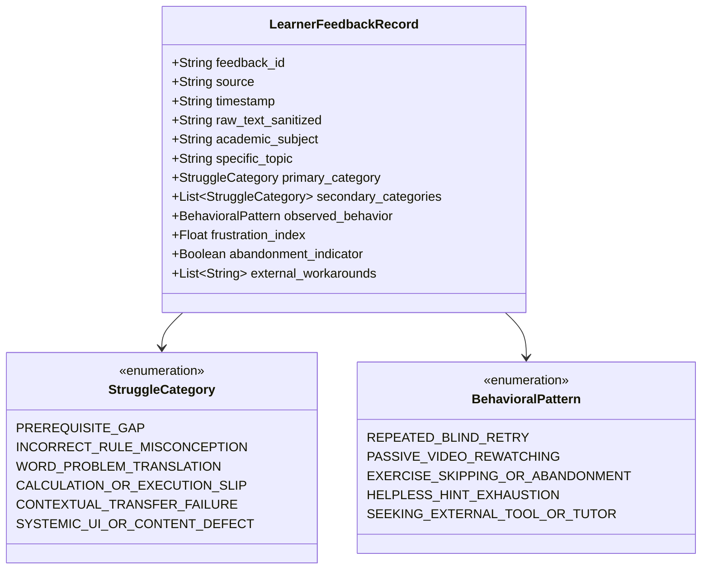
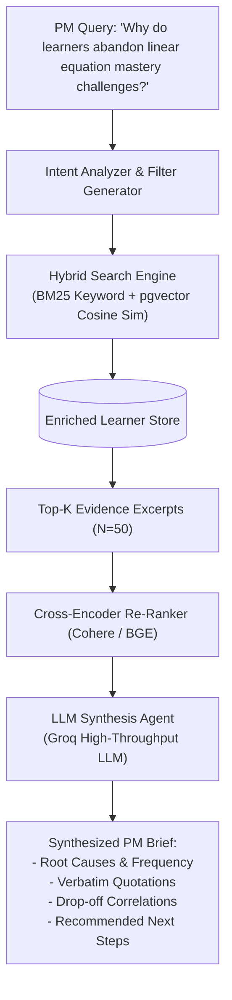
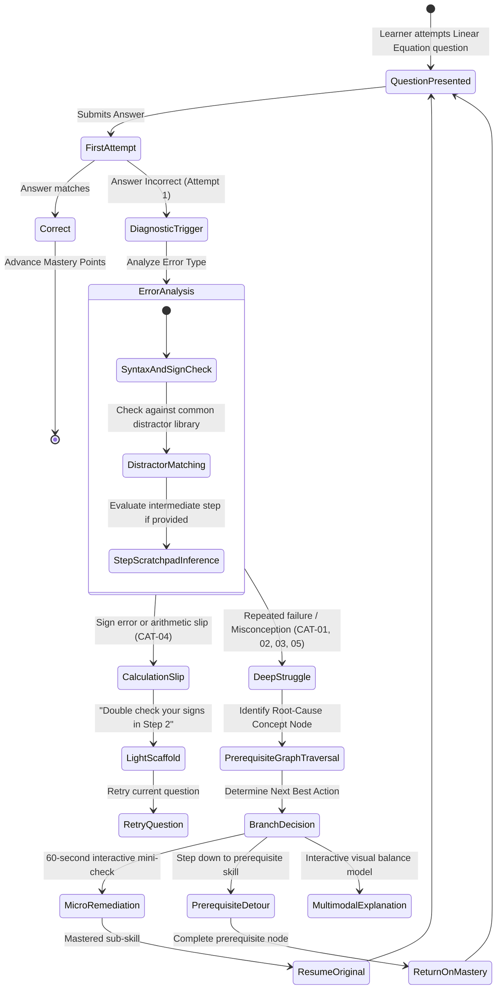
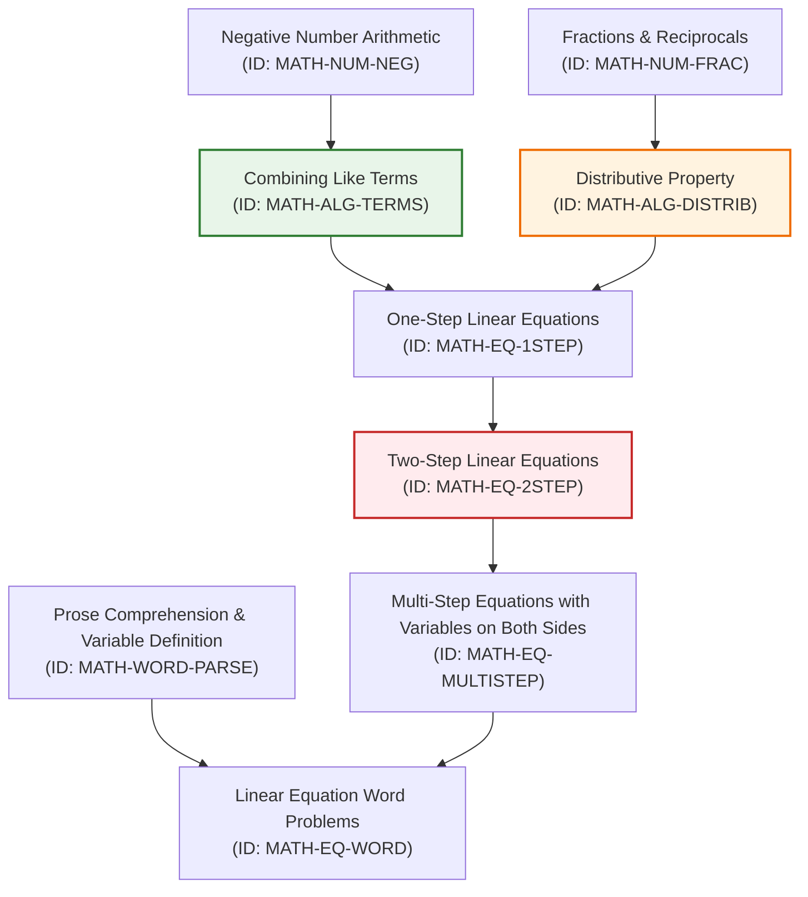
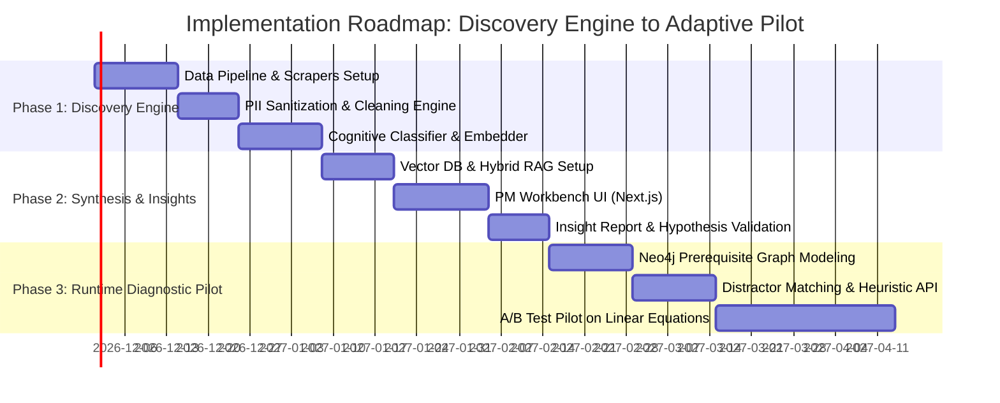

# System Architecture: AI-Powered Learner Discovery & Diagnostic Mastery Engine

**Document:** Architecture Specification  
**Project:** Khan Academy Learning Experience – Portfolio Case Study  
**Reference Document:** [ps.md](file:///d:/Khan%20Academy%20-%20Portfolio/docs/ps.md)  
**Author:** Product Manager, Learning Experience Team  
**Status:** Draft / Proposed Architecture  

---

## 1. Executive Summary & Architectural Vision

Khan Academy's strategic mission is to provide a free, world-class education for anyone, anywhere, grounded in **mastery-based learning**. In typical mathematical learning paths (e.g., linear equations), learners often encounter friction where repeated errors lead to demoralization, unproductive practice loops, and eventual drop-off. 

To address the core challenge outlined in [ps.md](file:///d:/Khan%20Academy%20-%20Portfolio/docs/ps.md), the system architecture is structured into two synergistic subsystems:

1. **Subsystem 1: AI-Powered Discovery Engine (PM & Research Layer):**  
   An automated, multi-source intelligence engine that continuously extracts, processes, semantically tags, and clusters unstructured public learner discussions (Reddit, App Stores, YouTube, Community Forums). It surfaces root-cause taxonomies, learner struggle behaviors, and drop-off predictors to validate hypotheses and guide product strategy.
2. **Subsystem 2: Cognitive Diagnostic & Adaptive Remediation Engine (Target Product Layer):**  
   An in-product, real-time diagnostic architecture integrated into Khan Academy's practice loop. When repeated struggles occur, it bypasses generic hints to pinpoint the exact cognitive failure mode (prerequisite gap, misconception, translation block, calculation slip, or transfer failure) and dynamically prescribes the highest-leverage remediation step.



---

## 2. High-Level System Architecture

The end-to-end architecture follows a modular, decoupled microservice pattern with event-driven pipelines for discovery batch processing and low-latency API endpoints for in-product diagnostics.



---

## 3. Subsystem 1: AI-Powered Discovery Engine (Detailed Design)

The primary goal of Subsystem 1 is to answer the 9 core discovery questions identified in [ps.md](file:///d:/Khan%20Academy%20-%20Portfolio/docs/ps.md#L60-L70) using real empirical evidence from learner discussions.

### 3.1 Data Ingestion & Source Connectors

| Source | Access Mechanism | Extraction Scope | Volume Target | Key Signals Captured |
| :--- | :--- | :--- | :--- | :--- |
| **Reddit** | PRAW / Reddit API | `r/Khan`, `r/learnmath`, `r/algebra`, `r/education` | ~15,000 threads/yr | Friction points, unguided abandonments, study hacks |
| **App Store (iOS)** | Apple RSS / Scraping API | Rating $\le 3$, search keywords: *stuck, hints, quiz, algebra* | ~5,000 reviews/yr | Exercise UX complaints, unhelpful explanations |
| **Google Play** | `google-play-scraper` | 1-3 star reviews + filtered 4-5 stars with struggle keywords | ~10,000 reviews/yr | Bug reports vs. pedagogical barriers, mobile fatigue |
| **YouTube** | YouTube Data API v3 | Comments on top 100 Khan Academy Linear Equation videos | ~30,000 comments | Exact timestamps of confusion, specific concept questions |
| **KA Community** | Zendesk public / Web Archive | Math forum threads, feature requests, help tickets | ~8,000 threads | Repeated questions, requests for alternative step-by-step |

### 3.2 Ingestion & Sanitization Pipeline



### 3.3 Cognitive Taxonomy & Classification Schema

Learner statements are categorized according to the **5 Cognitive Failure Modes** outlined in the problem statement:



#### Taxonomy Definition Matrix

| Category Code | Failure Mode | Definition & Diagnostic Indicator | Sample Learner Utterance |
| :--- | :--- | :--- | :--- |
| **CAT-01** | **Prerequisite Gap** | Learner lacks foundational understanding of previous concepts (e.g., negative numbers, fractions). | *"I can't solve $2x + 5 = -3$ because negative numbers still confuse me."* |
| **CAT-02** | **Rule Misconception** | Applying an erroneous mathematical rule or heuristic. | *"Divided both sides by 2, but didn't divide the constant term."* |
| **CAT-03** | **Translation Gap** | Difficulty translating prose into mathematical variables and relations. | *"I understand how to solve equations, but word problems make no sense to me."* |
| **CAT-04** | **Execution Slip** | Conceptual logic is sound, but arithmetic/sign slip causes failure. | *"I knew what to do, but dropped a minus sign in step 3 and lost all mastery stars."* |
| **CAT-05** | **Transfer Gap** | Can solve standard formulaic exercises, fails when structure varies. | *"As soon as $x$ appears on both sides or in the denominator, I blank out."* |

### 3.4 Discovery Synthesis & RAG Query Architecture

To enable Product Managers to query this database conversational-style, an agentic Retrieval-Augmented Generation (RAG) architecture is implemented:



---

## 4. Subsystem 2: Cognitive Diagnostic & Adaptive Mastery Engine (In-Product Design)

This subsystem translates discovery findings into an active product capability within Khan Academy's learning loop.

### 4.1 In-Product Diagnostic Loop

When a learner answers incorrectly on Khan Academy today, they typically see a generic red indicator, an option to "Show summary/hints", or an invitation to retry. The new architecture introduces a **Diagnostic Interceptor**:



### 4.2 Mathematical Prerequisite Knowledge Graph (DAG)

The engine models skills as a Directed Acyclic Graph (DAG) stored in Neo4j, enabling graph traversals when deep conceptual breakdowns occur.



*Scenario:* If a learner fails $3(2x - 4) = 18$ by answering $6x - 4 = 18$, the system classifies this as failure of node `MATH-ALG-DISTRIB` (Distributive Property) rather than failure of `MATH-EQ-MULTISTEP`. Instead of re-testing multi-step equations, the learner is dynamically presented with a 2-question micro-refresher on distributing constants over binomials.

---

## 5. Data Models & API Specifications

### 5.1 JSON Schema: Diagnostic Event Payload

```json
{
  "$schema": "http://json-schema.org/draft-07/schema#",
  "title": "LearnerAttemptDiagnosticEvent",
  "type": "object",
  "properties": {
    "event_id": { "type": "string", "format": "uuid" },
    "timestamp": { "type": "string", "format": "date-time" },
    "user_id": { "type": "string" },
    "exercise_id": { "type": "string" },
    "topic_slug": { "type": "string", "example": "linear-equations-variables-both-sides" },
    "attempt_number": { "type": "integer", "minimum": 1 },
    "time_spent_seconds": { "type": "number" },
    "submitted_answer": { "type": "string" },
    "expected_answer": { "type": "string" },
    "scratchpad_strokes_count": { "type": "integer" },
    "hints_requested": { "type": "integer" },
    "diagnostic_result": {
      "type": "object",
      "properties": {
        "failure_mode": { 
          "type": "string", 
          "enum": ["PREREQUISITE_GAP", "RULE_MISCONCEPTION", "TRANSLATION_GAP", "EXECUTION_SLIP", "TRANSFER_GAP", "NONE"] 
        },
        "identified_concept_gap": { "type": "string", "example": "distributive-property-signs" },
        "confidence_score": { "type": "number", "minimum": 0.0, "maximum": 1.0 },
        "prescribed_action": {
          "type": "string",
          "enum": ["MICRO_CONCEPT_CHECK", "STEP_BY_STEP_SCAFFOLD", "PREREQUISITE_REROUTE", "ALLOW_RETRY"]
        },
        "remediation_target_id": { "type": "string", "example": "micro-distrib-prop-negatives" }
      },
      "required": ["failure_mode", "confidence_score", "prescribed_action"]
    }
  },
  "required": ["event_id", "timestamp", "user_id", "exercise_id", "attempt_number", "submitted_answer", "diagnostic_result"]
}
```

### 5.2 API Interface: Runtime Diagnostic Service

```http
POST /api/v1/learning-experience/diagnose-attempt
Content-Type: application/json
Authorization: Bearer <session_token>

{
  "user_id": "usr_998124a8",
  "exercise_id": "ex_lin_eq_multistep_04",
  "problem_latex": "3(x - 2) + 4 = 19",
  "submitted_answer": "x = 7",
  "correct_answer": "x = 7",
  "attempt_history": [
    { "attempt": 1, "answer": "x = 5", "latency_ms": 42000 },
    { "attempt": 2, "answer": "x = 9", "latency_ms": 28000 }
  ],
  "client_context": {
    "platform": "web",
    "screen_width": 1440,
    "scratchpad_active": false
  }
}
```

#### Response Payload:
```http
HTTP/1.1 200 OK
Content-Type: application/json

{
  "status": "success",
  "diagnosis": {
    "failure_mode": "RULE_MISCONCEPTION",
    "root_cause_explanation": "Learner likely neglected to distribute the factor 3 across the negative term, obtaining 3x - 2 instead of 3x - 6.",
    "target_prerequisite_id": "MATH-ALG-DISTRIB",
    "recommended_intervention": {
      "type": "INTERACTIVE_CALLOUT",
      "scaffold_message": "Notice the parentheses around (x - 2). When you expand 3(x - 2), remember to multiply 3 by both x and -2.",
      "action_button": {
        "label": "Try distributing again",
        "action_type": "RETRY_WITH_STEP_PROMPT"
      }
    }
  }
}
```

---

## 6. Technology Stack Selection & Trade-Off Analysis

| Layer | Recommended Technology | Alternatives Evaluated | Rationale & Trade-Offs |
| :--- | :--- | :--- | :--- |
| **Orchestration & ETL** | **Prefect 3.0 / Python** | Apache Airflow, n8n | Prefect provides dynamic pythonic task workflows, native async support, and rapid prototyping compared to heavy Airflow infrastructure. |
| **Discovery LLM** | **Groq API (Qwen 2.5 / GPT-OSS / Llama 3.3)** | Claude 3.5, OpenAI GPT-4o | Ultra-low latency (~250-500 tokens/sec), cost-effective high-throughput batch classification and RAG synthesis with structured JSON output conformance. |
| **Runtime Diagnostic** | **Groq Llama-3.1-8B-Instant + Rules Engine** | Direct closed-source cloud APIs | Runtime requires $<200\text{ ms}$ latency at scale. Groq LPU engine delivers $<120\text{ ms}$ TTFT combined with rule-based distractor matching for $<20\text{ ms}$ instant responses. |
| **Embeddings** | **BAAI BGE Model (bge-large-en-v1.5 / bge-base-en-v1.5)** | OpenAI text-embedding-3-large, Cohere v3 | Top-ranked open-weights embedding model on MTEB (1024-dimension dense semantic representations), domain adaptation capability, zero per-token API dependency, and specialized retrieval query instruction prefixing. |
| **Vector Database** | **pgvector (PostgreSQL)** | Pinecone, Qdrant | Single ACID-compliant store combines relational metadata (timestamps, sources, user IDs) with vector embeddings without cross-database synchronization overhead. |
| **Graph Database** | **Neo4j** | Amazon Neptune, NetworkX | Native Cypher queries make prerequisite DAG traversal and transitive closure queries (e.g., all ancestors of linear equations) intuitive and fast. |
| **PM Workbench Frontend** | **Next.js 14 + TailwindCSS** | Streamlit | Streamlit is excellent for proof-of-concept, but Next.js provides long-term production readiness, custom data visualizations, and interactive filtering. |

---

## 7. Security, Privacy & Ethical Compliance

1. **Student Data Privacy (COPPA & FERPA Compliance):**
   * All public forum ingestion runs through a multi-pass PII anonymization pipeline (stripping names, schools, email addresses, usernames, and geo-locations) before LLM embedding or storage.
   * In-product diagnostic logging uses hashed pseudonymous student identifiers (`user_hash`), isolated from Personally Identifiable Information databases.
2. **Pedagogical Hallucination Prevention:**
   * In-product remediation responses do not generate open-ended mathematical theories on the fly.
   * LLMs are constrained to **classify** learner errors into pre-approved, curriculum-aligned pedagogical intervention templates authored by Khan Academy domain experts.
3. **Data Licensing & Terms of Service:**
   * Discovery crawlers strictly respect `robots.txt`, official API rate limits (Reddit API terms, Google Play API guidelines, YouTube v3 quotas), and caching policies.

---

## 8. Implementation Roadmap



### Milestones & Deliverables
* **Milestone 1 (Discovery Engine Operational):** Ingestion pipelines processing Reddit, app stores, and YouTube comments with $\ge 90\%$ classification accuracy into the 5 struggle categories.
* **Milestone 2 (Discovery Insights Report):** Evidence-backed dossier identifying top prerequisite drop-off points in middle/high school algebra.
* **Milestone 3 (In-Product Prototype):** A working pilot on Linear Equations demonstrating real-time distractor analysis and prerequisite redirection, targeting a $\ge 15\%$ reduction in exercise abandonment.
