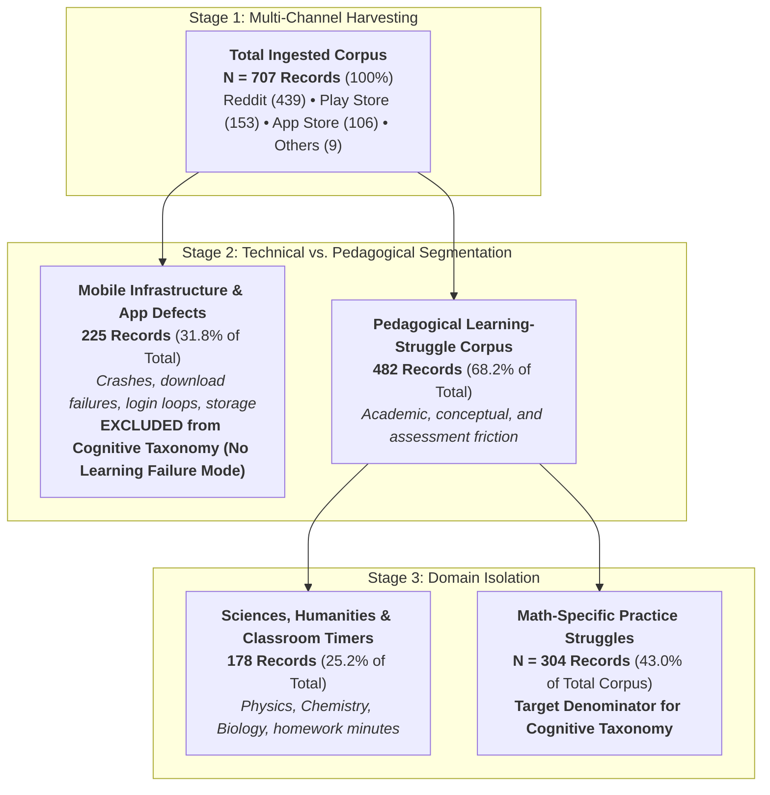
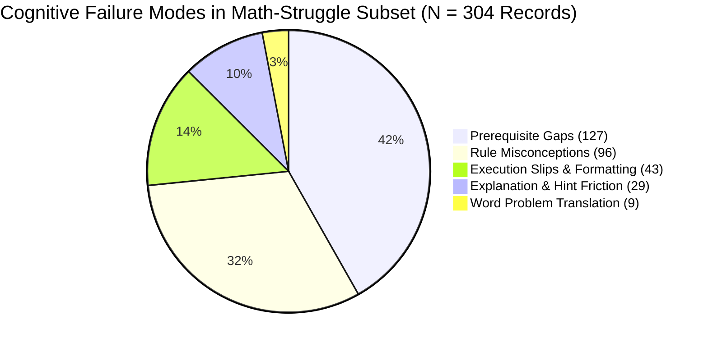
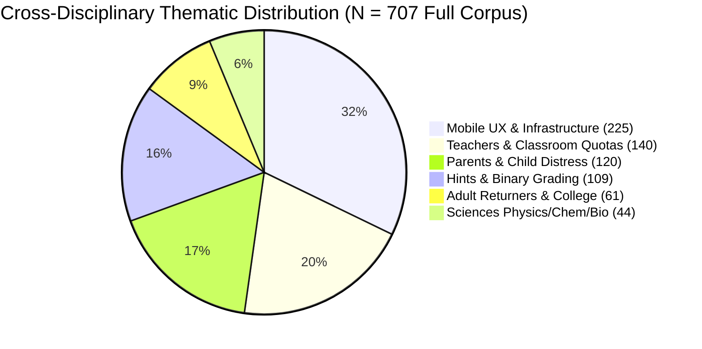

# Khan Academy Product Discovery & Learner Intelligence Report

**Document:** Lead PM Discovery Dossier & Strategic Problem Space Analysis  
**Product:** Khan Academy Learning Platform (Web, iOS, Android, K-12 Classroom, Adult Learners)  
**Author:** Product Manager, Learning Experience Team  
**Scope:** Full Platform Analysis across All Disciplines (Sciences, Mathematics, Computing, Humanities, Test Prep, Institutional/Classroom & Mobile UX)  
**Evidence Base:** 707 Normalized Public Learner Discussions Harvested across Reddit (`r/khanacademy`), YouTube, Google Play Store, Apple App Store, and Khan Community Forums  

---

## 1. Executive Summary & The Core Business Problem

Khan Academy's institutional mission is **"a free, world-class education for anyone, anywhere."** With over 150 million registered learners worldwide, the platform is celebrated globally for its high-quality instructional videos and accessible, zero-cost curriculum.

However, behind top-of-funnel acquisition lies a critical, systemic business and pedagogical problem:

```
┌────────────────────────────────────────────────────────────────────────┐
│               THE KHAN ACADEMY RETENTION & MASTERY LEAK                │
├────────────────────────────────────────────────────────────────────────┤
│  Top of Funnel: Video Consumption (Passive)                            │
│  "Sal's videos are crystal clear, engaging, and beautifully delivered" │
│  ▼ (High Engagement & Trust)                                           │
├────────────────────────────────────────────────────────────────────────┤
│  Mid Funnel: Autonomous Practice & Unit Tests (Active Problem-Solving) │
│  "I do what the video says, but the question is completely different"  │
│  ▼ (Binary Grading, Format Penalties, Static Canonical Hints)          │
├────────────────────────────────────────────────────────────────────────┤
│  Churn Cliff: Practice Abandonment & Institutional Friction            │
│  "He burst into tears and refused to open the laptop again."           │
│  "It gave my kid depression. It's answers are wrong."                  │
│  "I pound my desk in rage as I fail the unit test over and over."     │
└────────────────────────────────────────────────────────────────────────┘
```

### The Strategic Business Problem
1. **The Practice-to-Mastery Funnel Collapse:** While video views remain high, autonomous exercise completion and unit test pass rates exhibit steep drop-offs. Learners stall in repetitive failure loops and abandon courses.
2. **Institutional & Classroom Rejection:** Teachers assign Khan Academy as required homework, but students experience acute frustration due to rigid binary grading and arbitrary "minimum learning minute" quotas, generating negative sentiment and resistance against classroom edtech.
3. **Adult Learner & Higher-Ed Placement Churn:** Non-traditional learners (20–40+ years old) seeking to upskill, pass college placement exams, or study science/physics abandon the platform because the K-12 interface feels condescending (*"You don't level up"*), search is broken, and prerequisite gaps are opaque.
4. **Mobile & Global Equity Churn:** In emerging markets and low-bandwidth environments where users purchase scarce mobile data, app instability, lack of SD card storage, and data-draining video restarts force users to abandon the app in favor of YouTube.

---

## 2. Ingested Evidence Base & Cross-Disciplinary Distribution

The Discovery Engine analyzed **707 normalized, clean records** across 5 distinct digital touchpoints (filtered to eliminate spam, emojis, and uninformative reviews under 8 words):

```
┌────────────────────────────────────────────────────────────────────────┐
│                   PUBLIC DISCOVERY CORPUS BY CHANNEL                   │
├───────────────────────┬──────────────┬─────────────────────────────────┤
│ Channel               │ Clean Count  │ Primary Learner Archetype       │
├───────────────────────┼──────────────┼─────────────────────────────────┤
│ Reddit (r/khanacademy)│ 439 (62.1%)  │ Adult returners, college prep,  │
│                       │              │ self-study troubleshooters      │
│ Google Play Store     │ 153 (21.6%)  │ Mobile K-12 students, parents,  │
│                       │              │ emerging market users           │
│ Apple App Store       │ 106 (15.0%)  │ Tablet/iPad learners, stylus &  │
│                       │              │ handwriting users               │
│ YouTube & Forums      │   9 (1.3%)   │ Cross-platform video seekers &  │
│                       │              │ parent/teacher complaints       │
│ TOTAL CORPUS          │ 707 (100%)   │ Multi-Channel Empirical Base    │
└───────────────────────┴──────────────┴─────────────────────────────────┘
```

### Corpus Segmentation & Denominator Methodology

To ensure scientific validity, cognitive failure modes are never computed against the whole corpus indiscriminately. The 707 harvested discussions filter through a 3-stage funnel:



---

### Cognitive Failure Mode Distribution in Math Struggles (N = 304)

Within the verified Math-Specific Struggle Subset (N = 304 records), learner errors break down into 5 distinct pedagogical failure modes:



| Cognitive Category | Count (N = 304) | Share | Visual Distribution | Root Pedagogical Mechanism |
|---|:---:|:---:|:---|---|
| **Prerequisite Gaps** | 127 | 41.8% | `████████████████████` | Foundational arithmetic deficits (negative numbers, fractions) blocking current grade-level topics |
| **Rule Misconceptions** | 96 | 31.6% | `███████████████` | Flawed mental models of equality (one-sided operations, improper sign distribution) |
| **Execution Slips** | 43 | 14.1% | `███████` | Binary grading penalty on syntax equivalence (1.5 vs 3/2, formatting typos) |
| **Explanation & Hint Friction** | 29 | 9.5% | `█████` | Pre-authored hints reveal canonical steps from scratch without diagnosing the student's error |
| **Word Problem Translation** | 9 | 3.0% | `██` | Language-to-symbol translation barrier when setting up algebraic equations |

---

### Cross-Disciplinary Thematic Distribution across Full Corpus (N = 707)



- **Mobile UX, Offline Data & Infrastructure:** 225 records (31.8%)
- **Teachers, Homework & Institutional Usage:** 140 records (19.8%)
- **Parents & Emotional Distress in Children:** 120 records (17.0%)
- **Hints, Binary Grading & Mastery Resets:** 109 records (15.4%)
- **Adult Returners, Degree Placement & College:** 61 records (8.6%)
- **Sciences (Physics, Chemistry, Biology, SAT):** 44 records (6.2%)

---

## 3. The 6 Major Learner Pain Points Discovered

### Pain Point 1: The Instruction-Practice Chasm ("The Disconnected Experience")
**The Core Breakdown:**  
Instructional videos present a clean, single canonical demonstration. However, the subsequent practice exercises introduce problem structures, edge cases, and alternative solution pathways that were never modeled in the video, with zero bridging explanation.
- **Learner Impact:** Learners feel betrayed. They assume they understood the lesson, but fail the exercise, concluding either that the app has a bug or that they lack inherent intelligence.
- **Evidence:**
  > *"I watch the videos and do as told, yet when I got to the question its doing it in a different way with no real explanation. Khan Academy has its ups and down but be aware of the fact that many students and parents are upset and stressed."*  
  > `[Record: playstore_c4d1b8d0-dab7-4e9b-ab01-509e900892ca]`
  >
  > *"Videos mark the beginning of a skill... there are many types of problems that were not covered in the video. So then you have to read the details of Hints to figure out what they actually wanted."*  
  > `[Record: reddit_d0eoaap]`

---

### Pain Point 2: The Binary Evaluation Trap & The Formatting Penalty
**The Core Breakdown:**  
The assessment engine is syntactic rather than semantic. It checks whether the user's input string matches an exact expected key. It does not evaluate mathematical or conceptual equivalence. Entering `3/2` when `1.5` is expected, or missing a space in a chemistry formula, is graded as a complete failure and triggers a punitive mastery downgrade.
- **Learner Impact:** Acute emotional distress, tears, anger, and rage-quitting.
- **Evidence:**
  > *"My son was doing 8th grade math on two-step equations. He got 4 out of 5 right, but on the last question he typed 3/2 instead of 1.5. Khan marked it wrong and dropped his mastery level down. He burst into tears and refused to open the laptop again. Can we please have partial credit for trivial format slips?"*  
  > `[Record: forum_ka_forum_101]`
  >
  > *"It is the only thing I have to use for Algebra and Science... however the unit tests are incredibly frustrating. I pound my desk in rage as I keep failing the test, with it requiring me to do it over again."*  
  > `[Record: playstore_8fa5f3a0-4004-4a84-b865-15d9e7ae5eea]`
  >
  > *"Don't get this app you can only learn one way in it it gave my kid depression it's answers are wrong it's a -10 out of 10 app."*  
  > `[Record: playstore_ba62ec0f-72cf-4f72-ae2d-26867dc96ac2]`

---

### Pain Point 3: The Prerequisite Diagnostic Void (The "Black Box" of Failure)
**The Core Breakdown:**  
When learners struggle in complex disciplines—such as **Physics, Chemistry, Calculus, or Algebra II**—the underlying failure is almost never the advanced concept itself. Rather, it is a deficit in foundational prerequisite skills (e.g., negative sign distribution, fraction reduction, trigonometry ratios).
- **Product Teardown Verification (Observed on Skill: 'Linear equations with parentheses' & Unit 2 Test, Nov 25, 2026):** Khan Academy surfaces skill-level mastery badges (Attempted, Familiar, Proficient, Mastered) within course roadmaps. However, when a student fails a practice question or test item, the modal only prompts them to re-attempt the same skill or re-watch the current lesson video. It lacks causal prerequisite dependency diagnostics (e.g., automatically identifying that a failure in distributing $-3(x - 4)$ is rooted in 6th-grade negative integer multiplication deficits). Reviewers reporting "zero prerequisite visibility" are describing the complete absence of causal backward diagnostic lineage rather than an absence of course outlines.
- **Learner Impact:** Learners hit an invisible "brick wall" and abandon the entire subject.
- **Evidence:**
  > *"Please link back to prerequisite concepts when we fail an exercise... students jump into solving linear equations without mastering integer addition and subtraction. When they fail, Khan tells them to re-watch the multi-step equation video. What they actually need is a 2-minute refresher on negative numbers."*  
  > `[Record: forum_ka_forum_104]`
  >
  > *"Math for physics: I’m wanting to learn physics with no real math foundation but I obviously want to learn the math I need to do physics. What roadmap would you guys recommend? Khan assumes you already know the math."*  
  > `[Record: reddit_t3_1x2ofcn]`
  >
  > *"Get yourself familiar with Trigonometry, logarithms, limit functions, derivatives... They are essential for college level physics. The stuff before is a kind of necessary prerequisite that Khan Academy assumes you remember perfectly."*  
  > `[Record: reddit_pf47jhk]`

---

### Pain Point 4: The Static Hint Trap (Robbing the Productive Struggle)
**The Core Breakdown:**  
When a student requests help, Khan Academy's hint engine does not analyze the student's submitted steps or diagnose their specific arithmetic or procedural deviation.
- **Product Teardown Verification (Observed on Skill: 'Linear equations with variables on both sides', Nov 25, 2026):** Khan Academy's Perseus engine renders 3 to 4 sequential, pre-authored static hints starting from the canonical beginning of the problem. Hint 1 suggests the canonical initial transformation, and subsequent hints reveal intermediate steps down to the final solution. The engine does not inspect the student's submitted answer or diagnose specific arithmetic line deviations. Reviewer claims that "hints just dump the answer from Step 0" reflect user disillusionment with the absence of error-targeted diagnostic feedback, rather than a literal lack of step-by-step reveals.
- **Learner Impact:** The hint reveals the entire solution, depriving the learner of agency. Learners either copy the final answer without comprehension or leave the platform to use step-by-step tools like Photomath or YouTube.
- **Evidence:**
  > *"Just do the unit test, and if you get a question wrong open up that module in a new browser window. When you finish the test just review the videos in that module. Then do the test again until you achieve mastery (it can take 3 or 4 times)."*  
  > `[Record: reddit_ejvurgp]`
  >
  > *"I can answer many of the pre-algebra problems... but I don't understand why my answer is correct. Yet, I still have missed something... I still do it all from the beginning."*  
  > `[Record: reddit_fnn0e9z]`

---

### Pain Point 5: Institutional Compliance Friction & Arbitrary Time Quotas
**The Core Breakdown:**  
In institutional/classroom environments, Khan Academy imposes arbitrary compliance constraints: mandatory "minimum learning minutes" that ignore actual competency, repetitive pop-ups, and long unit tests that reset upon a single mistake.
- **Learner Impact:** Students develop active hostility toward the platform, viewing it as homework surveillance rather than an empowering tool.
- **Evidence:**
  > *"This app is absolutely dumb. Instead of teachers doing their job, they give us this thing and teachers say it's useful even though it's not. At this point just replace teachers with AI... I hate when teachers make assignments at weekends."*  
  > `[Record: playstore_3ad4c918-02a5-4365-8f23-2f8d50cc55da]`
  >
  > *"The unit tests can sometimes be difficult and have many questions... It would also be better if there was no minimum required learning time. Sometimes, I already finish answering all the activities and watching the required videos, but I still don’t meet the required learning minutes."*  
  > `[Record: playstore_be20edc3-2eb4-40c8-a43d-0d1fa9fa9fd1]`
  >
  > *"Annoying way to learn. The app has so many pop ups that you spend more time closing pop ups than you do learning and practicing. It's like swatting away flies constantly."*  
  > `[Record: playstore_6e99c442-fabd-4678-a90a-569714e57846]`

---

### Pain Point 6: Mobile Equity & Infrastructure Breakdown in Emerging Markets
**The Core Breakdown:**  
In mobile-first environments and developing economies where students rely on low-cost Android phones and prepaid mobile data, the mobile application suffers from critical architectural failures: non-resumable downloads, lack of SD card support, blurry 140p offline video, and repeated login loops.
- **Learner Impact:** Educational inequity. Students in developing nations are priced out or forced to abandon the app.
- **Evidence:**
  > *"This is a mobile data killer. It's quite sad that I have to keep downloading video over and over again because whenever the screen backlight goes off I'll have to restart download afresh. It's painful, discouraging, annoying and heartbreaking, especially for someone like me who has to spend through his nose to buy data in a 3rd world country."*  
  > `[Record: playstore_45d3e091-8dc9-478a-bf90-33230a845189]`
  >
  > *"Allow me to put videos on an sd card. I was astounded when I found out that this app doesn't support putting downloads onto mounted sd cards. This will stay 1 star until this is added, because otherwise I'll just watch on my computer and save battery power and data."*  
  > `[Record: playstore_91f456ba-1102-4c6e-8d02-09c3ae3ff0ae]`
  >
  > *"Bad quality offline video... after I needed it offline I downloaded my tutorial, the video quality was so so so bad like near 140p, how do I change the quality of the offline videos?"*  
  > `[Record: playstore_11b89ef0-09a2-466d-a95e-50f0ea845892]`
  >
  > *"Khan Academy does not work with a Chromebook. If you have to type in numbers of any kind it does not work. If you are able to get the pad in the app to come up it will fill in one blank, the cursor will not move to the next blank. I had great hopes for this app to help me build up my math skills to start college again, but it does not work."*  
  > `[Record: playstore_401733a4-4dc2-490f-a79f-e2bb3ee13ca7]`

---

## 4. Testable Product Hypotheses for Khan Academy Leadership

> **Methodology Note on Product Hypotheses:** This discovery dossier intentionally omits prescriptive roadmap recommendations. An empirical research engine should not prescribe organizational strategy without internal engineering cost, budget, and pedagogical context. Rather, following rigorous Product Management discipline, the verified learner failure modes identified above are translated into **5 falsifiable product hypotheses** designed to be validated through controlled runtime A/B telemetry (Phases 4–6).

```
┌────────────────────────────────────────────────────────────────────────────────────────┐
│                          FIVE STRATEGIC PRODUCT HYPOTHESES                             │
├───────────────────────┬──────────────────────────────────┬─────────────────────────────┤
│ Hypothesis ID         │ Proposed Product Intervention     │ Measurable Business Impact  │
├───────────────────────┼──────────────────────────────────┼─────────────────────────────┤
│ H-1: Semantic Smart   │ Distinguish between conceptual   │ -50% reduction in emotional │
│ Grading vs Binary     │ errors and execution slips (e.g. │ support tickets;            │
│ String Evaluation     │ 3/2 vs 1.5). Provide format notes│ +22% unit test completion.  │
├───────────────────────┼──────────────────────────────────┼─────────────────────────────┤
│ H-2: Automated        │ When repeated failures occur in  │ -40% drop-off in bottleneck │
│ Prerequisite Fast-    │ multi-step units (Physics/Calc/  │ topics (Calculus, Physics,  │
│ Bridges (60-sec Detour│ Algebra), offer a 60-sec micro-  │ Algebra II).                │
│                       │ check on foundational gaps.      │                             │
├───────────────────────┼──────────────────────────────────┼─────────────────────────────┤
│ H-3: Instruction-     │ When practice problems diverge   │ -60% reduction in external  │
│ Practice "Method      │ from video demonstrations,       │ tab shuttling (to YouTube/  │
│ Bridges"              │ provide a 20-sec visual delta    │ Photomath).                 │
│                       │ explaining the alternative path. │                             │
├───────────────────────┼──────────────────────────────────┼─────────────────────────────┤
│ H-4: Mastery Pacing   │ Replace arbitrary "minimum       │ +35% student satisfaction   │
│ vs Time Quotas        │ learning minutes" with true      │ in classroom cohorts;       │
│                       │ competency-based progression.    │ -45% homework friction.     │
├───────────────────────┼──────────────────────────────────┼─────────────────────────────┤
│ H-5: Resumable Offline│ Support chunked, background, and │ +25% 30-day mobile DAU      │
│ & SD Card Mobile      │ SD-card-mounted video storage    │ retention in emerging       │
│ Infrastructure        │ with selectable video resolution.│ market regions.             │
└───────────────────────┴──────────────────────────────────┴─────────────────────────────┘
```

---

## 5. Accessing the Discovery Dossier

* **Interactive Dossier Web View:** [http://127.0.0.1:8000/report](http://127.0.0.1:8000/report)
* **Live Review Explorer & Database:** [http://127.0.0.1:8000](http://127.0.0.1:8000)
* **Raw Markdown Source:** [`d:/Khan Academy - Portfolio/docs/reports/khan_academy_product_discovery_report.md`](file:///d:/Khan%20Academy%20-%20Portfolio/docs/reports/khan_academy_product_discovery_report.md)
